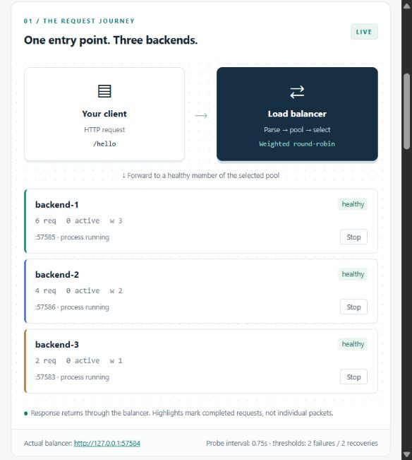

# Smart Load Balancer for Distributing Web Traffic

An educational Layer 7 HTTP load balancer built with Python and asyncio.

**Current milestone: Week 3 — review-ready.** Round-robin, least-connections,
weighted round-robin, active HTTP health checks, path-based pools, JSON
configuration, structured request logs, and live statistics are implemented.
Traffic Lab adds a browser classroom with guided experiments and failure controls.
The HTTP subset and remaining limitations are stated below.

## Quick start

Python 3.11+; no third-party packages. Tested on Windows with Python 3.13.0.

Clone the repository and enter its folder (GitHub access is required while it is private):

~~~sh
git clone https://github.com/DhruvD0202/smart-load-balancer.git
cd smart-load-balancer
~~~

If you already have the project locally, open a terminal in that folder instead.

### Browser classroom (one terminal)

~~~powershell
python demo_app.py
~~~

Open **http://127.0.0.1:8090** if the browser does not open automatically. Send
real traffic, compare algorithms, stop/restart demo backends, inspect responses
and live stats, and save evidence. Built-in explanations and three guided
experiments help with verbal reviews. The app starts its own private servers;
leave its terminal running and press Ctrl+C to stop them.

See the [browser demo guide](docs/browser-demo.md) for a five-minute walkthrough
and an explanation of how the interface connects to the existing asyncio code.

Preview: real weighted traffic split across three backends

### Original terminal demonstration

Stop older demo backend and balancer processes with Ctrl+C before reusing their
ports. Open each terminal in this project folder.

**Terminal 1 — start the three demo backends:**

~~~powershell
python run_backends.py
~~~

**Terminal 2 — start the balancer and append JSON logs to a file:**

~~~powershell
python load_balancer.py --config config.json --log-file balancer.jsonl
~~~

**Terminal 3 — send requests and view statistics:**

~~~powershell
python demo_week2.py
python watch_stats.py --once
curl.exe --max-time 5 "http://127.0.0.1:8080/stats"
~~~

For a continuously refreshing terminal display, run python watch_stats.py in a
fourth terminal. Ctrl+C stops the display. Stop the backend launcher and balancer
with Ctrl+C in their own terminals.

The launcher stops its entire group if a child exits. For a manual single-server
failure demonstration, use independent backend terminals as shown in the
[Week 3 guide](docs/week3.md), or run the self-contained demo below.

## One-command Week 3 review

~~~powershell
python demo_week3.py
~~~

This starts its own three backend processes and balancer on temporary loopback
ports. It compares algorithms, stops/restarts its own backends, verifies
mid-response failure handling, checks 503 responses and /stats, and cleans up
its processes. It works alongside the manual demo without using its ports.

Observed results from the saved run:

| Check | Result |
| --- | --- |
| Round-robin, six requests | 1, 2, 3, 1, 2, 3 |
| Weighted, weights 3:2:1, twelve requests | Backend counts 6:4:2 |
| Least-connections, one slow request on backend-1 | Six fast requests alternated between backends 2 and 3 |
| Backend-2 stopped and recovered | Removed from selection, then rejoined after successful probes |
| Response truncated | Client detected incomplete body; request logged as incomplete |
| Static pool unavailable | /static returned 503 while /api still worked |
| All backends down | Requests returned 503; /stats remained available; active count returned to 0 |

Full output: [demo.txt](docs/evidence/week3/demo.txt).
JSON request/health events: [health_recovery.jsonl](docs/evidence/week3/health_recovery.jsonl).
Final stats: [final-stats.json](docs/evidence/week3/final-stats.json).

The demo uses faster probe intervals and a controlled workload. These checks
show behavior, not a production throughput or availability benchmark.

## Select an algorithm

Edit algorithm in [config.json](config.json), then restart the balancer, or
override it for one run:

~~~powershell
python load_balancer.py --algorithm round_robin
python load_balancer.py --algorithm least_connections
python load_balancer.py --algorithm weighted_round_robin
~~~

Run only one of these on port 8080 at a time. Health checks apply to every
algorithm. Weights are positive integers on backend definitions (3, 2, 1 in the
sample). Only weighted_round_robin uses weights. The implementation uses smooth
weighted round-robin, which spreads selections through a cycle.

Least-connections counts active assignments globally per backend across pools,
including connection setup and response transfer. It reserves a slot before
awaiting I/O and releases it in finally after socket cleanup. Health probes do
not count. Ties rotate fairly within a pool.

Validate before starting:

~~~powershell
python load_balancer.py --config config.json --check-config
~~~

## Routing and architecture

| Path | Pool | Members |
| --- | --- | --- |
| /api or /api/... | api | backend-1, backend-2 |
| /static or /static/... | static | backend-3 |
| Unmatched paths, including /apiculture | default | all three |
| /stats (GET / HEAD) | Local monitoring endpoint | no backend |

~~~mermaid
flowchart LR
    C["HTTP clients"] --> P["asyncio HTTP balancer :8080"]
    P --> R["Path routing + healthy backend selection"]
    R --> B1["backend-1 :9001"]
    R --> B2["backend-2 :9002"]
    R --> B3["backend-3 :9003"]
    H["Background HTTP health checks"] --> B1
    H --> B2
    H --> B3
    H --> S["Shared health and request state"]
    R <--> S
    S --> M["Local /stats + terminal display"]
    P --> L["JSON request logs"]
~~~

The client and backend use separate TCP connections. A bounded HTTP request is
parsed before selecting a backend, then its response body streams back in
chunks. Choosing a destination using the HTTP path is a Layer 7 decision.

Each client has an asyncio handler. A background coroutine probes all backends
concurrently using GET /health. TaskGroup supervises health checks alongside
the listener. On shutdown, the checker is cancelled and active handlers clean
up their sockets and reservations.

## Health and stats contract

Default health settings: enabled, path /health, 2-second interval after each
completed probe round, 1-second probe timeout, two consecutive failures to
mark down, and two consecutive successes to restore a down backend.

Backends start unknown and are excluded until the first successful startup
probe. A first success admits an unknown backend; recovery from unhealthy
requires the full recovery threshold. Probes require HTTP 200 and a complete
Content-Length body of at most 64 KiB.

Requests can fail before a probe threshold detects a problem. Once a pool has
no eligible members, it returns 503; it never silently falls back to another pool.
A TCP accept alone is not a successful health check.

The /stats endpoint reports health, weights, active assignments, request counts,
completed/failed/cancelled transfers, HTTP error responses, average response
duration, and health-check results. Reads of /stats and health probes do not
advance routing cursors or backend request counts.

For each backend:

~~~text
requests = active + completed + failed + cancelled
~~~

Completed means the HTTP response transfer finished, including a backend's
complete 4xx/5xx response. Such statuses are also counted in http_error_responses.
Failed means the assigned transfer did not complete. Average/last response
durations use completed transfers only and run from client acceptance through
response forwarding, including upload/backend waits but excluding socket cleanup.
They are not backend CPU time, TCP RTT, or a client-side benchmark.

Stats reset on balancer restart. JSON logs use UTC ISO timestamps and include
client IP, method, path (without query), chosen pool/backend, status, outcome,
response_time_ms, and an error if present. Bodies and header values are not logged.

## Verification and learning guides

~~~powershell
python -m unittest discover -s tests -v
python demo_week3.py
~~~

The full suite passed **60 tests**, covering parsing, routing, algorithms,
health transitions, stats isolation, cancellation and failure cleanup, and the
original TCP behavior, plus the browser controller's real-process experiments.
See the [browser verification record](docs/evidence/browser-demo/verification.txt).
Socket tests may need a regular local terminal if a
restricted execution environment blocks Windows asyncio networking.

- [Week 1: TCP and asyncio foundation](docs/week1.md)
- [Week 2: HTTP parsing and path routing](docs/week2.md)
- [Week 3: algorithms, health checks, stats, and review checklist](docs/week3.md)
- [Browser classroom: setup, teaching notes, and demo checklist](docs/browser-demo.md)
- [Four-week roadmap](docs/roadmap.md)

The original TCP proxy remains runnable as proxy.py. The HTTP entry point is
load_balancer.py. The Week 2 checker expects round-robin and all backends healthy.
Its unattended historical demo disables health checks to preserve Week 2's
failure behavior:

~~~powershell
python tests/smoke_week2.py
~~~

## Supported HTTP subset and limitations

- HTTP/1.1 clients; GET, HEAD, POST; one request per connection. POST requires
  Content-Length. Headers default to 16 KiB, request bodies to 1 MiB, and ASCII
  request targets to 2,048 characters. Requests are buffered before forwarding.
- Backend responses use Content-Length, with separate no-body handling for
  HEAD / 204 / 304. Chunked and close-delimited responses are unsupported.
- Connection-specific headers are removed, Host is preserved, and
  Connection: close is explicit. No keep-alive reuse, pipelining, upgrades,
  Expect / 100-continue, HTTP/2, or TLS termination.
- Routing uses the literal case-sensitive path before the query. Percent escapes
  and dot segments are not normalized; routing pools are not authorization rules.
- Default whole-phase deadlines: 5 s headers, 5 s body, 3 s backend connection,
  10 s backend exchange. There is no global connection cap.
- Failure before a response yields 502/504; no eligible backend yields 503.
  After headers are sent, failure closes the incomplete stream without appending
  a second response. Requests are not replayed or retried.
- Health reflects the configured probe endpoint, not correctness of every route.
  A /truncate demo route intentionally fails while /health remains healthy.
- The demo backends return identifying JSON, including for /static paths.
  They are test fixtures, not an API service or file-hosting implementation.
- Intended for local coursework demos. /stats has no authentication; the supplied
  listener binds to 127.0.0.1. No production HTTP conformance/security claim.
- Week 4 deliverables remain: final report, PPT, final experiment discussion,
  screenshots, and rehearsal. TLS is an optional stretch goal.

## Resume bullet for implemented work

Built an asyncio HTTP load balancer with round-robin, least-connections and
weighted scheduling, path-based pools, active HTTP health checks, JSON logging
and live metrics; validated backend failure/recovery and request accounting
with 60 automated tests and an interactive three-backend browser demo.
